# AI Tourism — MVP Entity Relationship Diagram

- **Version:** 0.1
- **Status:** Schema-derived documentation; not a proposed migration
- **Database baseline:** 2026-11-05 — PostgreSQL 17 / PostGIS 3.6.4 / pgvector 0.8.7
- **Evidence:** `database/tourism_points.sql`, `engineering/database-prep/sql/000_bootstrap.sql`, `001_core_schema.sql`, migrations `005` and `006`, and the successful owner-run database test output.

## 1. Scope and accuracy

This ERD documents the **current physical MVP schema**, not every conceptual entity in the broader reference architecture. It includes all 30 project-owned tables in eight schemas. Column lists in the diagram are key identifiers and relationship fields, not exhaustive table definitions; the SQL migrations remain authoritative for exact types, checks, indexes, defaults and delete behavior.

Table inventory:

| Schema | Tables | Count |
|---|---|---:|
| `identity` | users, user_consents, user_preferences | 3 |
| `conversation` | conversations, messages | 2 |
| `travel` | trips, trip_constraints, trip_interests, itineraries, itinerary_stops | 5 |
| `knowledge` | knowledge_sources, destinations, destination_sources, destination_tags, destination_categories, destination_category_map, knowledge_documents, knowledge_chunks, embedding_spaces, chunk_embeddings | 10 |
| `recommendation` | recommendation_requests, recommendations, recommendation_score_components | 3 |
| `integration` | external_links, outbound_clicks | 2 |
| `operations` | feedback, ai_model_calls, audit_events, dataset_import_batches | 4 |
| `system` | schema_migrations | 1 |
| **Total** | **Project-owned tables** | **30** |

The four foundational knowledge tables (`knowledge_sources`, `destinations`, `destination_sources`, `destination_tags`) originate in the legacy `database/tourism_points.sql` file and are upgraded by the current migrations. The bootstrap creates `system.schema_migrations`; `001_core_schema.sql` creates the other 25 tables.

## 2. ER diagram

```mermaid
erDiagram
    users {
        uuid user_id PK
        text auth_subject
        text email
        text phone_e164
        text account_status
    }
    user_consents {
        uuid consent_id PK
        uuid user_id FK
        text consent_type
        text policy_version
    }
    user_preferences {
        uuid preference_id PK
        uuid user_id FK
        text preference_key
        jsonb preference_value
    }
    conversations {
        uuid conversation_id PK
        uuid user_id FK
        text conversation_status
        jsonb structured_context
    }
    messages {
        uuid message_id PK
        uuid conversation_id FK
        text role
        text idempotency_key
    }
    trips {
        uuid trip_id PK
        uuid user_id FK
        uuid conversation_id FK
        text origin_text
        date start_date
        date end_date
    }
    trip_constraints {
        uuid constraint_id PK
        uuid trip_id FK
        uuid source_message_id FK
        text constraint_key
        text constraint_strength
    }
    trip_interests {
        uuid trip_interest_id PK
        uuid trip_id FK
        text interest_key
    }
    itineraries {
        uuid itinerary_id PK
        uuid trip_id FK
        uuid recommendation_request_id FK
        int version
        int day_count
    }
    itinerary_stops {
        uuid itinerary_stop_id PK
        uuid itinerary_id FK
        bigint destination_id FK
        int day_number
        int stop_order
    }
    knowledge_sources {
        bigint source_id PK
        text source_name
        text verification_status
        text url
        boolean is_synthetic
    }
    destinations {
        bigint destination_id PK
        bigint parent_destination_id FK
        text destination_key
        text destination_type
        text status
        text coordinate_role
        geography location
    }
    destination_sources {
        bigint destination_id PK, FK
        bigint source_id PK, FK
        text source_role
    }
    destination_tags {
        bigint destination_id PK, FK
        text tag PK
    }
    destination_categories {
        bigint category_id PK
        text category_key
        text name_fa
    }
    destination_category_map {
        bigint destination_id PK, FK
        bigint category_id PK, FK
        text mapping_source
    }
    knowledge_documents {
        uuid document_id PK
        bigint source_id FK
        bigint destination_id FK
        text document_key
        text content_sha256
    }
    knowledge_chunks {
        uuid chunk_id PK
        uuid document_id FK
        int chunk_index
        text content_sha256
    }
    embedding_spaces {
        uuid embedding_space_id PK
        text space_key
        text model_name
        int vector_dimension
    }
    chunk_embeddings {
        uuid chunk_embedding_id PK
        uuid chunk_id FK
        uuid embedding_space_id FK
        vector embedding
    }
    recommendation_requests {
        uuid recommendation_request_id PK
        uuid trip_id FK
        uuid conversation_id FK
        text algorithm_version
        text retrieval_version
    }
    recommendations {
        uuid recommendation_id PK
        uuid recommendation_request_id FK
        bigint destination_id FK
        int rank
        numeric final_score
    }
    recommendation_score_components {
        uuid score_component_id PK
        uuid recommendation_id FK
        text component_key
        numeric weighted_score
    }
    external_links {
        uuid external_link_id PK
        bigint destination_id FK
        text provider_name
        text target_url
    }
    outbound_clicks {
        uuid outbound_click_id PK
        uuid external_link_id FK
        uuid user_id FK
        uuid trip_id FK
        uuid recommendation_id FK
    }
    feedback {
        uuid feedback_id PK
        uuid user_id FK
        uuid conversation_id FK
        uuid trip_id FK
        uuid recommendation_id FK
    }
    ai_model_calls {
        uuid ai_model_call_id PK
        uuid correlation_id
        text provider_name
        text model_name
    }
    audit_events {
        uuid audit_event_id PK
        uuid actor_user_id FK
        text action
        text resource_type
    }
    dataset_import_batches {
        uuid dataset_import_batch_id PK
        bigint source_id FK
        text batch_key
        text data_class
    }
    schema_migrations {
        text migration_id PK
        text sha256
    }

    users ||--o{ user_consents : has
    users ||--o{ user_preferences : has
    users o|--o{ conversations : owns
    conversations ||--o{ messages : contains
    users o|--o{ trips : creates
    conversations o|--o{ trips : contextualizes
    trips ||--o{ trip_constraints : constrains
    messages o|--o{ trip_constraints : evidence
    trips ||--o{ trip_interests : includes
    trips ||--o{ recommendation_requests : requests
    conversations o|--o{ recommendation_requests : context
    recommendation_requests ||--o{ recommendations : returns
    destinations ||--o{ recommendations : candidate
    recommendations ||--o{ recommendation_score_components : explains
    trips ||--o{ itineraries : plans
    recommendation_requests o|--o{ itineraries : basis
    itineraries ||--o{ itinerary_stops : contains
    destinations ||--o{ itinerary_stops : scheduled
    destinations o|--o{ destinations : parent_of
    destinations ||--o{ destination_sources : evidenced_by
    knowledge_sources ||--o{ destination_sources : supports
    destinations ||--o{ destination_tags : tagged
    destinations ||--o{ destination_category_map : classified
    destination_categories ||--o{ destination_category_map : classifies
    knowledge_sources ||--o{ knowledge_documents : originates
    destinations o|--o{ knowledge_documents : describes
    knowledge_documents ||--o{ knowledge_chunks : split_into
    knowledge_chunks ||--o{ chunk_embeddings : embedded_as
    embedding_spaces ||--o{ chunk_embeddings : defines_space
    destinations o|--o{ external_links : links
    external_links ||--o{ outbound_clicks : clicked
    users o|--o{ outbound_clicks : user_context
    trips o|--o{ outbound_clicks : trip_context
    recommendations o|--o{ outbound_clicks : recommendation_context
    users o|--o{ feedback : submits
    conversations o|--o{ feedback : about
    trips o|--o{ feedback : about_trip
    recommendations o|--o{ feedback : about_recommendation
    users o|--o{ audit_events : actor
    knowledge_sources o|--o{ dataset_import_batches : import_source
```

## 3. Aggregate and ownership guidance

These are application-level boundaries inferred from the current relationships; they do not add database tables or claim that every aggregate must be persisted in one transaction.

| Aggregate / module | Root | Owned or dependent records | Notes |
|---|---|---|---|
| Identity | `identity.users` | consents, preferences | Consent and preferences currently cascade on user deletion. Authentication provider is not selected. |
| Conversation | `conversation.conversations` | messages | A conversation may be associated with a user; current FK uses `ON DELETE SET NULL`. |
| Trip | `travel.trips` | constraints, interests, itineraries; itinerary stops through itinerary | Constraints may cite a source message. The trip can reference a conversation and user. |
| Destination catalogue | `knowledge.destinations` | tags, category map, source links; external links | Source records are shared; many-to-many provenance uses `destination_sources`. Parent-child destination relation is self-referential. |
| Knowledge content | `knowledge.knowledge_documents` | chunks, chunk embeddings through chunks | A document requires a source and may optionally reference a destination. Embedding spaces are shared versioned model spaces. |
| Recommendation | `recommendation.recommendation_requests` | recommendations and score components | The request records algorithm/retrieval version and an input snapshot. |
| Integration activity | `integration.external_links` | outbound clicks | Clicks reference allowlisted link records; associated user/trip/recommendation context is nullable. |
| Operations | Individual event/record | feedback, AI calls, audit events, import batches | These are not one business aggregate; retain correlation and provenance where present. |
| Schema lifecycle | `system.schema_migrations` | none | Migration ledger is infrastructure metadata. |

## 4. Important relationship and deletion semantics

- `user_consents` and `user_preferences` cascade when a user row is deleted.
- `conversations.user_id`, `trips.user_id`, `feedback.user_id` and several activity actor/context references use `ON DELETE SET NULL`; they do **not** erase the related conversation, message, trip or feedback payload.
- `trip_constraints.source_message_id` uses `ON DELETE SET NULL`; the constraint survives deletion of the source message.
- Knowledge documents restrict deletion of their source; documents optionally detach from a destination; chunks cascade with document deletion; embeddings cascade with chunk or embedding-space deletion.
- Recommendations restrict deletion of referenced destinations. Itineraries/stops and recommendation records have their own cascade paths.
- The database FK behavior alone does not implement a complete privacy deletion workflow. See [Security and privacy boundaries](../security/SECURITY_PRIVACY_BOUNDARIES_v0.1.md).

## 5. Current data and publication facts

The owner-run test report on 2026-11-05 confirmed:

- 30 tables and 419 total rows, all exact per-table counts passing;
- 44 destinations: 15 pending legacy, 12 synthetic QA and 17 verified-external UNESCO destinations;
- the 17 UNESCO destinations remain `needs_review`;
- production destination and production retrieval views are empty;
- `embedding_spaces` and `chunk_embeddings` persist zero rows;
- the RAG storage test inserts synthetic 3D/4D vectors in a rollback transaction; it does not populate persistent embeddings or prove semantic retrieval quality.

See `engineering/database-prep/docs/EXPECTED_ROW_COUNTS.md` and the SQL migrations for the exact column/check/index contract.
