# Rahgard National Catalogue and Partner Data — Logical/Physical ERD v1

**Status:** Stage 2A design proposal. Existing entities are audited facts; every green entity below is proposed and requires migration review. Partner objects remain gated by owner decisions in ADR-0009–0013. No schema or live data was changed by this package.

## Legend and reuse rules

- **Existing (blue)** means the object is in the Stage 1 live manifest, not that every row is published.
- **Proposed (green)** means an additive object for a later migration.
- Do not replace `knowledge.destinations`, `knowledge.knowledge_sources`, destination-source links, categories, documents, chunks, embeddings, claim evidence, import batches, enrichment proposals, published views, or traveler tables.
- The audited publication view `knowledge.production_destinations` currently yields zero rows. A base-table row is not a published destination.

```mermaid
erDiagram
  %% Existing catalogue, provenance, ingestion and RAG entities
  DESTINATIONS ||--o{ DESTINATION_SOURCES : supported_by
  KNOWLEDGE_SOURCES ||--o{ DESTINATION_SOURCES : supports
  DESTINATIONS ||--o{ DESTINATION_CATEGORY_MAP : classified_by
  DESTINATION_CATEGORIES ||--o{ DESTINATION_CATEGORY_MAP : classifies
  KNOWLEDGE_SOURCES ||--o{ KNOWLEDGE_DOCUMENTS : supplies
  DESTINATIONS o|--o{ KNOWLEDGE_DOCUMENTS : about
  KNOWLEDGE_DOCUMENTS ||--o{ KNOWLEDGE_CHUNKS : chunked_as
  DESTINATIONS ||--o{ DESTINATION_CLAIM_EVIDENCE : claims
  KNOWLEDGE_DOCUMENTS ||--o{ DESTINATION_CLAIM_EVIDENCE : cites
  KNOWLEDGE_CHUNKS ||--o{ DESTINATION_CLAIM_EVIDENCE : grounds
  DATASET_IMPORT_BATCHES ||--o{ DESTINATION_ENRICHMENT_PROPOSALS : stages
  DESTINATIONS ||--o{ DESTINATION_ENRICHMENT_PROPOSALS : target

  %% Proposed national hierarchy and candidate review
  ADMIN_AREA_RELEASES ||--o{ ADMIN_AREAS : contains_snapshot
  ADMIN_AREAS o|--o{ ADMIN_AREAS : parent_of
  ADMIN_AREAS ||--o{ ADMIN_AREA_ALIASES : named_as
  ADMIN_AREAS o|--o{ DESTINATIONS : canonical_admin_area
  DATASET_IMPORT_BATCHES ||--o{ DATASET_IMPORT_FILES : has_file
  DATASET_IMPORT_FILES ||--o{ DESTINATION_CANDIDATES : contains_rows
  DESTINATION_CANDIDATES ||--o{ CANDIDATE_REVIEWS : reviewed_by
  DESTINATIONS o|--o{ DESTINATION_CANDIDATES : resolved_to
  DESTINATIONS ||--o{ DESTINATION_LOCALIZATIONS : localized
  DESTINATIONS ||--o{ DESTINATION_ALIASES : alternate_name
  DESTINATIONS ||--o{ VISITOR_ACCESS_POINTS : access_point
  VISITOR_ACCESS_POINTS o|--o{ OPERATIONAL_ASSERTIONS : has_fact
  DESTINATIONS ||--o{ VISIT_DURATION_EVIDENCE : duration_evidence

  %% Proposed partner workspace; implementation gated by ADR decisions
  PARTNER_ORGANIZATIONS ||--o{ PARTNER_MEMBERSHIPS : grants_membership
  USERS ||--o{ PARTNER_MEMBERSHIPS : member
  PARTNER_ORGANIZATIONS ||--o{ PARTNER_INVITATIONS : invites
  PARTNER_ORGANIZATIONS ||--o{ PARTNER_VERIFICATION_CASES : verification
  PARTNER_ORGANIZATIONS ||--o{ PARTNER_BRANCHES : operates
  ADMIN_AREAS o|--o{ PARTNER_BRANCHES : located_in
  PARTNER_ORGANIZATIONS ||--o{ PARTNER_SERVICES : owns
  PARTNER_BRANCHES o|--o{ PARTNER_SERVICES : delivers_at
  PARTNER_SERVICES ||--o{ PARTNER_SERVICE_LOCALIZATIONS : localized
  PARTNER_SERVICES ||--o{ PARTNER_SERVICE_DESTINATIONS : relevant_to
  DESTINATIONS ||--o{ PARTNER_SERVICE_DESTINATIONS : destination
  PARTNER_SERVICES ||--o{ PARTNER_OFFERS : offered_as
  PARTNER_OFFERS ||--o{ PARTNER_PRICES : priced_by
  PARTNER_SERVICES ||--o{ PARTNER_SCHEDULES : scheduled
  PARTNER_OFFERS ||--o{ PARTNER_AVAILABILITY_SNAPSHOTS : availability

  DESTINATIONS {
    bigint destination_id PK "existing"
    text destination_key UK "existing"
    text canonical_name "existing"
    text province_name "existing, preserve"
    text city_name "existing, preserve"
    geometry location "existing PostGIS"
    text coordinate_role "existing constrained"
    bigint parent_destination_id FK "existing"
    bigint admin_area_id FK "proposed nullable"
  }
  KNOWLEDGE_SOURCES {
    bigint source_id PK "existing"
    text url "existing"
    text verification_status "existing"
    boolean is_synthetic "existing"
  }
  DATASET_IMPORT_BATCHES {
    uuid dataset_import_batch_id PK "existing"
    text batch_key UK "existing"
  }
  ADMIN_AREA_RELEASES {
    uuid release_id PK "proposed"
    text authority "proposed"
    text source_url "proposed"
    text release_key "proposed"
    date effective_on "proposed"
  }
  ADMIN_AREAS {
    bigint admin_area_id PK "proposed"
    uuid release_id FK "proposed"
    text area_type "proposed"
    text official_code "proposed nullable"
    bigint parent_admin_area_id FK "proposed nullable"
    text canonical_name_fa "proposed"
  }
  ADMIN_AREA_ALIASES {
    bigint alias_id PK "proposed"
    bigint admin_area_id FK "proposed"
    text alias "proposed"
    text language "proposed"
  }
  DATASET_IMPORT_FILES {
    uuid file_id PK "proposed"
    uuid dataset_import_batch_id FK "proposed"
    text relative_path "proposed"
    char sha256 "proposed"
    bigint byte_size "proposed"
  }
  DESTINATION_CANDIDATES {
    uuid candidate_id PK "proposed"
    uuid file_id FK "proposed"
    text source_record_key "proposed"
    char row_sha256 "proposed"
    jsonb raw_record "proposed restricted"
    bigint canonical_destination_id FK "proposed nullable"
  }
  CANDIDATE_REVIEWS {
    uuid review_id PK "proposed append-only"
    uuid candidate_id FK "proposed"
    text identity_relation "proposed"
    bigint target_destination_id FK "proposed nullable"
    text decision "proposed"
    uuid reviewer_user_id FK "proposed nullable"
  }
  DESTINATION_LOCALIZATIONS {
    bigint destination_id PK,FK "proposed"
    text locale PK "proposed"
    text display_name "proposed"
    text description "proposed nullable"
    text review_status "proposed"
  }
  DESTINATION_ALIASES {
    uuid alias_id PK "proposed"
    bigint destination_id FK "proposed"
    text alias "proposed"
    text locale "proposed nullable"
  }
  VISITOR_ACCESS_POINTS {
    uuid access_point_id PK "proposed"
    bigint destination_id FK "proposed"
    geometry point "proposed nullable"
    text point_role "proposed"
    text review_status "proposed"
  }
  OPERATIONAL_ASSERTIONS {
    uuid assertion_id PK "proposed"
    bigint destination_id FK "proposed"
    text fact_type "proposed"
    text value_state "proposed"
    jsonb value "proposed nullable"
    timestamptz observed_at "proposed nullable"
    timestamptz valid_until "proposed nullable"
  }
  VISIT_DURATION_EVIDENCE {
    uuid duration_id PK "proposed"
    bigint destination_id FK "proposed"
    integer min_minutes "proposed nullable"
    integer max_minutes "proposed nullable"
    bigint source_id FK "existing source"
    timestamptz observed_at "proposed"
  }
  PARTNER_ORGANIZATIONS {
    uuid organization_id PK "proposed gated"
    text legal_name "proposed restricted"
    text display_name "proposed public reviewed"
    text verification_status "proposed"
    text participation_status "proposed"
  }
  PARTNER_MEMBERSHIPS {
    uuid membership_id PK "proposed gated"
    uuid organization_id FK "proposed"
    uuid user_id FK "existing identity.users"
    text role "proposed"
    text status "proposed"
  }
  PARTNER_INVITATIONS {
    uuid invitation_id PK "proposed gated"
    uuid organization_id FK "proposed"
    bytea token_hash "proposed restricted"
    timestamptz expires_at "proposed"
  }
  PARTNER_VERIFICATION_CASES {
    uuid case_id PK "proposed gated"
    uuid organization_id FK "proposed"
    text status "proposed"
    jsonb evidence_refs "proposed restricted"
    uuid reviewer_user_id FK "proposed"
  }
  PARTNER_BRANCHES {
    uuid branch_id PK "proposed gated"
    uuid organization_id FK "proposed"
    text display_name "proposed"
    bigint admin_area_id FK "proposed nullable"
    geometry location "proposed nullable"
  }
  PARTNER_SERVICES {
    uuid service_id PK "proposed gated"
    uuid organization_id FK "proposed"
    uuid branch_id FK "proposed nullable"
    text service_type "proposed"
    text status "proposed"
  }
  PARTNER_SERVICE_LOCALIZATIONS {
    uuid service_id PK,FK "proposed"
    text locale PK "proposed"
    text name "proposed"
    text description "proposed nullable"
  }
  PARTNER_SERVICE_DESTINATIONS {
    uuid service_id PK,FK "proposed"
    bigint destination_id PK,FK "existing"
    text relation_type "proposed"
  }
  PARTNER_OFFERS {
    uuid offer_id PK "proposed gated"
    uuid organization_id FK "proposed"
    uuid service_id FK "proposed"
    text status "proposed"
    timestamptz valid_from "proposed nullable"
    timestamptz valid_until "proposed nullable"
  }
  PARTNER_PRICES {
    uuid price_id PK "proposed gated"
    uuid offer_id FK "proposed"
    numeric amount "proposed nullable"
    char currency "proposed nullable"
    text price_state "proposed"
    timestamptz observed_at "proposed nullable"
  }
  PARTNER_SCHEDULES {
    uuid schedule_id PK "proposed gated"
    uuid service_id FK "proposed"
    timestamptz starts_at "proposed nullable"
    timestamptz ends_at "proposed nullable"
    text timezone "proposed nullable"
  }
  PARTNER_AVAILABILITY_SNAPSHOTS {
    uuid snapshot_id PK "proposed gated"
    uuid offer_id FK "proposed"
    text availability_state "proposed"
    timestamptz observed_at "proposed nullable"
    timestamptz valid_until "proposed nullable"
  }
```

## Relationship semantics

1. A candidate row is never a canonical destination. Only a reviewed operator action may link it to an existing destination or create a separately reviewed canonical row. The file and row snapshots remain immutable.
2. `same_entity` resolves to one existing canonical identity. `part_of_or_within` preserves a distinct child and may set the existing `parent_destination_id` only after a reviewed containment decision. `nearby_distinct` creates no parent/merge implication. `unresolved` has no canonical target.
3. Imam Mosque and Sheikh Lotfollah Mosque remain separate destination identities associated with Naqsh-e Jahan Square. A spatial-nearness result is a review signal only.
4. `knowledge.destinations.location` retains its existing meaning and coordinate-role constraint. A new `visitor_access_points.point` represents only a separately evidenced access/entrance point; it does not rewrite the destination point.
5. Partner service-destination links point to existing published canonical destinations; they do not own, duplicate, or publish those destinations.
6. Partner verification, participation, service submission and publication are separate states. Organization verification must not auto-publish a service or offer.

## Trust boundaries

Published catalogue and retrieval projections continue to read the existing canonical/provenance entities. Candidate review, localization drafts, operational observations and partner drafts are excluded until their independent publication rules pass. No proposed partner table is authorized for implementation until the owner resolves the listed gates and relevant ADRs.
