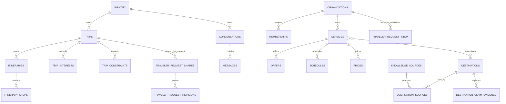

# Rahgard schema architecture and usage matrix - 2026-11-24

## Scope and interpretation

This is a metadata/source-code audit of one authorized PostgreSQL database, not a claim that every physical column is a distinct business requirement. No application rows were read. Relation owner and view definitions came from `docs/database/live-schema/catalog_metadata_snapshot.json` as read-only catalog metadata; SQL definitions are metadata only.

Database: `rahgard_pilot_vps_staging`; role: `ai_tourism_app`; server: `17.11 (Debian 17.11-1.pgdg13+2)`.
Objects: **101** (87 tables, 14 views); column occurrences: **1106**; view output occurrences with SQL lineage records: **167** (including first-party projections and PostGIS extension views).
The CSVs preserve unknowns. A static token match does not prove runtime use; absence of a match does not prove dead code. No migration, data change, or drop recommendation is made.

## Object decisions

Decision meanings: `KEEP` = observed code/required safety dependency; `CONSOLIDATE-LATER` = not assigned without demonstrated duplicate semantics; `LEGACY-COMPAT` = not assigned absent direct legacy evidence; `EXTENSION-MANAGED` = lifecycle owned by PostgreSQL/PostGIS; `INVESTIGATE` = no adequate evidence for an architectural necessity claim. These are preserve/review decisions, not schema approval.

| Decision | Objects |
|---|---:|
| KEEP | 61 |
| CONSOLIDATE-LATER | 0 |
| LEGACY-COMPAT | 0 |
| EXTENSION-MANAGED | 3 |
| INVESTIGATE | 37 |

## Per-schema object and column occurrence counts

| Schema | Objects | Tables | Views | Column occurrences | Existing glossary | Undocumented occurrences | Base-table undocumented | Derived view occurrences | Extension occurrences |
|---|---:|---:|---:|---:|---:|---:|---:|---:|---:|
| conversation | 3 | 3 | 0 | 40 | 25 | 15 | 15 | 0 | 0 |
| geo | 3 | 3 | 0 | 34 | 0 | 34 | 34 | 0 | 0 |
| identity | 11 | 11 | 0 | 84 | 0 | 84 | 84 | 0 | 0 |
| integration | 4 | 4 | 0 | 23 | 5 | 18 | 18 | 0 | 0 |
| knowledge | 39 | 28 | 11 | 503 | 0 | 503 | 353 | 150 | 0 |
| operations | 7 | 7 | 0 | 80 | 0 | 80 | 80 | 0 | 0 |
| partner | 19 | 18 | 1 | 200 | 200 | 0 | 0 | 3 | 0 |
| public | 4 | 2 | 2 | 20 | 0 | 20 | 1 | 0 | 19 |
| recommendation | 3 | 3 | 0 | 32 | 0 | 32 | 32 | 0 | 0 |
| system | 1 | 1 | 0 | 3 | 0 | 3 | 3 | 0 | 0 |
| travel | 7 | 7 | 0 | 87 | 0 | 87 | 87 | 0 | 0 |

Across this database snapshot, the baseline glossary has **230** matched column descriptions and **876** undocumented column occurrences (the sum includes derived-view and extension occurrences). These are occurrence counts, not distinct parameters or validated requirements.

### Glossary coverage by occurrence class

| Occurrence class | Total | Baseline glossary entry | No baseline entry |
|---|---:|---:|---:|
| first_party_application_base | 827 | 222 | 605 |
| first_party_system_or_operations | 107 | 5 | 102 |
| derived_view | 153 | 3 | 150 |
| extension_managed | 19 | 0 | 19 |

A missing baseline entry on a derived-view occurrence points to its lineage, not duplicate business prose. Extension-managed occurrences link to PostGIS documentation. First-party system/operations fields are not automatically end-user requirements.

Read-only PostgreSQL relation owners: `ai_tourism_owner`: 99 objects; `rahgard_pilot_geo_migrator`: 2 objects. These are database object owners, not business/product sign-off owners.

## Column occurrence categories

Counts below describe occurrences in base tables and views. The same logical source attribute may appear more than once in derived views; those rows are not independent business parameters.

See `column_occurrence_matrix.csv` for all typed occurrences, `view_column_lineage.csv` for each exact view expression/input, `foreign_key_edges.csv` for the live FK graph, and `api_dependency_map.csv` for literal relation references scoped to backend functions. Static absence is inconclusive. Glossary entries are the preserved 1fee6b5 baseline; missing meanings remain explicitly undocumented.

## Domain boundaries and relationship map

The Mermaid view summarizes domain boundaries, not a substitute for the exact live FK graph. `object_decision_matrix.csv` carries the catalog FK edges. Destination identity, source/evidence, and publication are separate: canonical destinations are not source records; claims remain evidence-linked; public catalogue access uses publication views. Conversation messages are not the canonical trip requirements; trip revisions and saved itinerary state remain distinct. Partner memberships and tenant-scoped rows are separate from platform reviewer grants. Traveler sharing requires explicit consent and scoped recipient eligibility; response revisions keep the same request identity.

## Risk and impact

| Change class | Risk | Required control |
|---|---|---|
| Drop/rename base relation or column | Critical data loss/API break | Prohibited here; prove consumer graph, migration/backup/restore and explicit owner approval first |
| Change view projection or publication predicate | High public-data/privacy impact | Preserve exact source/eligibility predicate; API contract and negative publication tests |
| Change partner FK/RLS/grants | Critical tenant-isolation risk | Isolated PG17, cross-tenant negative tests, reviewed additive migration |
| Change conversation/trip linkage | High persistence/privacy risk | Existing trip save/reopen and ownership tests |
| Extension catalog changes | Platform compatibility risk | PostgreSQL/PostGIS documented upgrade path; never treat as Rahgard business fields |
| Document-only correction | Low runtime risk | Drift validator and no live write |

## Coverage limitation

The prior 876 figure was missing glossary coverage among 1,106 column occurrences in this one database snapshot (1,106 minus 230 baseline glossary entries). It is not 876 validated requirements. Derived views repeat source attributes; extension and system metadata are not end-user fields. The matrices classify origins and evidence, but architecture necessity remains `INVESTIGATE` where no sufficient consumer/provenance evidence exists. No schema is declared rational or approved by this audit.
