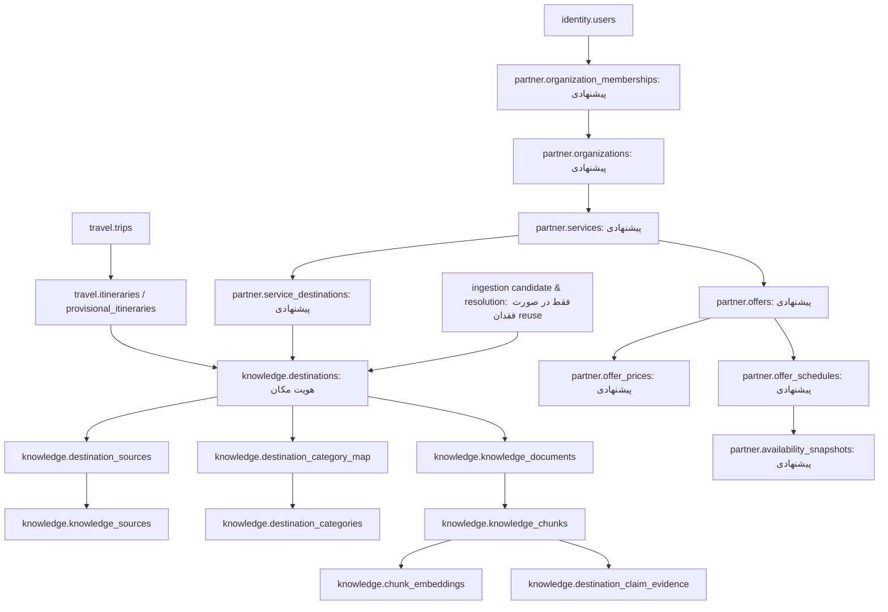

# Rahgard — جمع‌بندی ممیزی داده، معماری کاتالوگ ملی و شرکت‌ها (طرح قابل بازبینی v1)

**مبنا:** سورس مخزن `AiDev168/Ai_Tourism` در Commit `5e2664fb51e18f52549aa37a8b5793e12ace09b2`؛ پیوست «دیتابیس - توریسم.zip».  
**وضعیت:** Draft / design-only — هنوز با `pg_catalog` دیتابیس زنده تطبیق نشده، و هیچ Migration یا Import اجرا نشده است.

## ۱. هدف و ترتیب اجرا

1. **A — ممیزی موجودی و تطبیق با دیتابیس واقعی (read-only):** استخراج Schema واقعی VPS، Viewها، Constraintها، شاخص‌ها، مجوزها، Ledger و موجودی هویت‌های مکان؛ مقایسه با بسته‌های داده. خروجی: ماتریس reuse/change/new و گزارش تکراری‌ها، بی‌آنکه داده یا Schema تغییر کند.
2. **B — تثبیت معماری و قراردادهای داده:** تکمیل ERD با توجه به خروجی A؛ مشخص‌کردن جدول و ستون، نوع، nullable، FK، مالک داده، استاندارد جغرافیایی، شواهد و انتشار، قواعد dedup، جست‌وجو، API و فرم‌ها. وضعیت اسناد Partner Marketplace همچنان «پیشنهادی» است تا تصمیم مالک ثبت شود.
3. **C — کاتالوگ سراسری و ورود داده:** Migrationهای افزایشی ابتدا در PostgreSQL آزمایشی، ابزار ورود نسخه‌دار و قابل تکرار، کاتالوگ جست‌وجوی صفحه‌بندی‌شده، پنل بازبینی مالک، و انتشار مرحله‌ای؛ حفظ تمام داده‌های قبلی و سفرها.
4. **D — دامنهٔ شرکت‌ها:** پس از تثبیت هویت/مجوزها، افزوده‌شدن `partner.*`، پنل سازمان، خدمات، پیشنهاد قیمت، نوبت‌ها و بازبینی؛ جداسازی کامل از هویت عمومی مکان.
5. **E — غنی‌سازی RAG و برنامه‌ریزی واقعی:** نمایه‌سازی متن منتشرشده توسط موتور RAG مستقل مالک؛ قواعد زمان/قیمت/ظرفیت از SQL و نه Chunk؛ آزمون برنامه‌ریزی پوشش ملی و خدمات شرکت‌ها.

**اولویت کاری:** A → B → C → D؛ E در بخش اسناد قابل انجام موازی با C است، اما نباید انتشار کاتالوگ را بلوکه کند.

## ۲. چه چیزی قبلاً واقعاً وجود دارد و چه چیزی فقط پیشنهاد است؟

### موجود در DDL مخزن (نیازمند تطبیق با Live DB)

- `knowledge.destinations` و سلسله‌مراتب `parent_destination_id`، `destination_key`، نقش مختصات، PostGIS و وضعیت تأیید.
- `knowledge.destination_categories`, `destination_category_map`, `destination_tags`، منابع `knowledge_sources`, `destination_sources`.
- `knowledge.knowledge_documents`, `knowledge_chunks`, `embedding_spaces`, `chunk_embeddings`, `destination_claim_evidence` و Viewهای تولیدی مرتبط.
- `operations.dataset_import_batches`، `knowledge.destination_enrichment_proposals`, `destination_enrichment_proposal_sources` و جدول‌های خوراکی غیرمکانی. **این‌ها باید قبل از افزودن جدول ingestion تکراری بررسی شوند.**
- `identity.users`، `travel.trips`, `travel.itineraries`, `travel.itinerary_stops` و `travel.provisional_itineraries` (Migration 0017؛ اجرا روی VPS طبق گزارش Codex).
- `integration.external_links`, `integration.outbound_clicks`, `operations.audit_events`.

### مستند/پیشنهادی؛ نه جدول موجود

- `docs/architecture/PARTNER_MARKETPLACE_AND_ADMIN_PLATFORM_ARCHITECTURE_v1.0.md`، `PARTNER_MARKETPLACE_DOMAIN_CONTRACT_v1.0.md` و ADR-0009 تا ADR-0013: سازمان، شعبه، عضویت، خدمت، پیشنهاد، قیمت، زمان‌بندی، موجودی/ظرفیت و ارجاع؛ اسناد صریحاً **Proposed / Owner Decision Required** هستند.
- `geo.admin_areas`، `destination_access_points`، localizations دیتابیسی، ادعاهای عملیاتی تاریخ‌دار و Staging عمومیِ discovery باید پس از ممیزی بر اساس حداقل تغییر طراحی شوند؛ ایجاد تمام جدول‌های پیشنهادی پیشاپیش درست نیست.

### کاستی قابل مشاهده از کد فعلی

- `backend/app/modules/catalog/repository.py`: سقف `MAX_CATALOGUE_ITEMS=1000` و خواندن یکجای تمام کاتالوگ؛ فرانت‌اند نیز همین سقف را دارد. توسعه به چند هزار مقصد نیازمند query/filter/pagination سمت سرور و بازنگری candidate retrieval است.
- Aliasهای چندزبانه در فایل Manifest قرار دارند؛ برای ورود و ویرایش محتوای ملی، مدیریت پایدار ترجمه و Alias در DB با مهاجرت سازگار و بدون ازبین‌بردن فایل فعلی لازم است.
- تطبیق برچسب علاقه‌مندی‌ها به علت نبود locale در metadata فعلی عمداً در Recommendation غیرفعال است؛ لازم است taxonomy استاندارد و چندزبانه اضافه شود.
- `knowledge.production_destinations` فقط مکان‌های تأییدشده و فعال با نقش مختصات و منبع معتبر را نشان می‌دهد. مشکل خالی‌بودن View با پرکردن جدول خام حل نمی‌شود؛ نیاز به مسیر بازبینی و انتشار دارد.

## ۳. موجودی پیوست (شمارش محلی ZIP، نه موجودی VPS)

| داده | ردیف خام | هویت یکتا/توضیح | وضعیت |
|---|---:|---|---|
| `destinations.csv` | 177 | 167 `destination_key` یکتا؛ 10 تکرار در نسخهٔ تحویل مجدد Alborz Batch 001 | همه `verification_status=pending`; 136 ردیف خام دارای زوج مختصات (نه اثبات اعتبار) |
| `knowledge_documents.csv` | 531 | 501 `document_key` یکتا | همه `ingestion_status=pending` |
| `knowledge_chunks.csv` | 531 | موارد از قبل قطعه‌بندی شده؛ بدون embedding واقعی | نسخهٔ Chunk را بدون تأیید سیاست موتور RAG نهایی نکنید |
| `national_candidate_places.csv` | 533 | سرنخ پژوهشی سراسری 31 استان | همه needs_review / publishable=false؛ بدون مختصات |
| `discovery_candidates.csv` | 368 | پژوهش البرز در چند بسته | غالباً غیرقابل انتشار مستقیم |
| `new_discovery_candidates.csv` | 32 | پژوهش تکمیلی البرز | نیازمند تطبیق و بررسی |
| `karaj_city_candidates.csv` | 23 | سرنخ کرج | نیازمند تطبیق |
| `candidate_watchlist.csv` | 14 | موارد تحت پیگیری | نباید مستقیم به production منتقل شوند |
| `culinary_candidates.csv` | 69 | موضوع خوراکی؛ شامل تحویل تکراری | دانش غیرمکانی، نه Stop در نقشه |
| `intangible_heritage_candidates.csv` | 6 | میراث ناملموس | باید غیرمکانی باقی بماند مگر رویداد/محل مستقل ثابت شود |
| `route_candidates.csv` | 4 | کاندید مسیر | مسیر با مکان نقطه‌ای متفاوت است |
| `coordinate_evidence.csv` | 54 | مختصات پیشنهادشده همراه شواهد | بررسی نقش و دقت مکانی لازم است |

**هشدار dedup:** ۱۶۷ شناسه در بسته به معنای ۱۶۷ مکان *جدید در Live DB* نیست. تکراری‌های معنایی با کلید متفاوت، تطابق با رکوردهای قبلی و اختلاف نام استان/شهر فقط پس از قرائت دادهٔ زنده قابل تشخیص است.

**هشدار coordinate_role:** در پیوست نقش‌هایی چون `village_reference_point`, `unesco_component_reference`, `mapped_building_reference`, `pending` وجود دارد که با CHECK فعلی `destinations.coordinate_role` یکسان نیستند. باید raw value و منبع در staging بماند و معنای واقعی به نقش قابل انتشار نگاشت شود؛ هیچ‌کدام خودکار `visitor_entrance` نشوند.

## ۴. ERD منطقیِ پیشنهادی — استفادهٔ مجدد قبل از ساخت جدول

### قرارداد تکمیلیِ مکان (پیشنهاد؛ نام و نوع نهایی پس از مرحله A)

| داده/فیلد | نوع/قید پیشنهادی | اجباری هنگام ایجاد | مالک و مرجع اعتبار | جست‌وجو/API |
|---|---|---|---|---|
| `destination_key` | TEXT UNIQUE در جدول موجود | بله | سیستم/import mapping | lookup دقیق |
| `canonical_name` و `destination_type` | TEXT و taxonomy کنترل‌شده | بله | پژوهشگر؛ بازبین مالک | نام/نوع |
| `admin_area_id` یا نگاشت به `geo.admin_areas` | BIGINT FK (جدول جدید در صورت نیاز) | استان بله، شهر ممکن است NULL | مرجع تقسیمات کشوری | استان، شهرستان، شهر |
| `latitude`, `longitude`, `coordinate_role` | موجود؛ pair nullable؛ نقشه PostGIS | برای ثبت اولیه خیر؛ برای نمایش روی نقشه براساس policy | پژوهشگر با منبع؛ تأییدگر مکانی | bbox/radius |
| `localized_name`, `summary`, `description` | جدول فرزند `(destination_id, locale)` با UNIQUE؛ TEXT | نام فارسی بله، زبان‌های دیگر nullable تا تکمیل | ویراستار/ترجمه‌بین | full text / locale |
| `alias` | جدول فرزند با locale و نوع | خیر | ویراستار | normalize/search |
| `visit_duration_min/max` | INTEGER مثبت؛ min<=max | خیر | کارشناس + منبع | برنامه‌ریزی، فقط با سطح اطمینان |
| `access_points` | child FK; GEOGRAPHY + point_role + source | خیر | تأییدگر مختصات | route only when confirmed entrance |
| `opening_hours`, `ticket`, `accessibility` | records دارای `observed_at`, `valid_until`, `source_id` | خیر | متولی/منبع معتبر | filter با freshness و unknown |
| `publication_state`, `verified_at`, `reviewer_id`, `revision` | وضعیت/نسخه/تاریخ | هنگام انتشار بله | مدیر/بازبین | فقط published در public view |

### قرارداد مینیمال Staging (افزودن فقط بخش‌های مفقود)

- **Reuse:** `operations.dataset_import_batches` برای مشخصات بسته و checksum؛ `knowledge.destination_enrichment_proposals` برای تغییراتِ هویت موجود؛ `destination_enrichment_proposal_sources` برای شواهد محدود موجود.
- **Gap:** سرنخ مکان بدون مقصد canonical فعلی باید `candidate_key`, `batch_id`, `raw_name`, `raw_province`, `source_ref`, `resolution_status`, `matched_destination_id?`, `source_coordinate_raw?`, `coordinate_role_raw?`, `reviewer`, `reviewed_at`, `payload_sha256` داشته باشد. ایجاد جدول جدید تنها اگر ساختارهای موجود به‌درستی آن را پوشش نمی‌دهند.
- **Dedup:** اول exact `destination_key`، سپس شناسهٔ رسمی خارجی، سپس candidate group بر پایهٔ `normalized_name + admin_area + source identity + spatial proximity`؛ تطبیق احتمالی فقط صف انسانی است، نه auto-merge.
- **Idempotency:** batch checksum + source row key؛ دوباره‌خوانی یک Batch نباید دادهٔ جدید بسازد یا اطلاعات تأییدشده را بازنویسی کند.

### قرارداد مینیمال Partner (پیشنهادی؛ مستقل از کاتالوگ)

| جدول پیشنهادی | ستون‌های کلیدی و قیدهای اساسی | مالک/دسترسی |
|---|---|---|
| `partner.organizations` | `organization_id UUID PK`, legal/display name, type, public contacts, `verification_status`, `participation_status`, timestamps | شرکت می‌نویسد؛ تأیید مدیر جدا |
| `partner.organization_memberships` | `(organization_id FK, user_id FK)`, `role`, `status`, joined/revoked at؛ UNIQUE فعال | سرور بر اساس Principal، نه ID مرورگر |
| `partner.verification_cases` | organization FK, evidence reference (private), decision, reviewer FK, policy_version, timestamps | مدیر تأیید هویت |
| `partner.branches` | org FK, admin_area FK?, address, public_contact, coordinate/role? | شرکت در scope خود |
| `partner.services` | service_id, org FK, branch FK?, type, locale fields, duration, participant bounds, publication/revision | شرکت؛ انتشار پس از review |
| `partner.service_destinations` | service FK + existing `knowledge.destinations` FK؛ UNIQUE pair | شرکت ارتباط می‌دهد؛ ناشر صحت آن را بررسی می‌کند |
| `partner.offers` | offer_id, service FK, validity, status, revision, cancellation policy | شرکت؛ moderation |
| `partner.offer_prices` | offer FK, numeric amount, `currency_iso`, `display_denomination` (تومان/ریال), pricing_unit, inclusions/exclusions, validity, source & freshness | شرکت؛ قیمت از SQL نه RAG |
| `partner.offer_schedules` | offer FK, local date, start/end TIME, IANA timezone, state | شرکت |
| `partner.availability_snapshots` | schedule FK, status incl. unknown/on_request, capacity nullable, observed_at, expires_at | شرکت، همیشه timestamped |
| `partner.publication_reviews` | subject/revision, decision, reviewer, reason, policy version, timestamp | فقط مدیر |

**API پیشنهادی:** `GET /api/v1/catalog/destinations?province_id=&city_id=&category=&bbox=&q=&cursor=&limit=` با صفحه‌بندی و query سروری؛ `GET /api/v1/catalog/destinations/{id}`. برای شرکت‌ها پس از تأیید تصمیم‌های امنیتی: endpointهای org-scoped برای Draft/Submit و public endpoint فقط published. مسیرهای فعلی نباید ناگهان شکسته شوند؛ سازگاری/نسخه‌بندی لازم است.

## ۵. قواعد انتشار و RAG

- raw imported ≠ verified source ≠ editorially published؛ انتشار حداقل به هویت یکتا، منبع معتبر، وضعیت مرور، نقش معتبر مختصات و projection امن نیاز دارد. برای داده‌هایی که مشخصات ساعت/دسترسی ندارند، unknown را حفظ کنید نه اینکه انتشار کل مکان بی‌دلیل بلوکه شود.
- محتوای چندزبانه: زبان مبدأ و وضعیت بازبینی هر ترجمه ثبت شود؛ عبور سند از pending به processed/eligible فقط پس از workflow معتبر.
- chunk/embedding از دادهٔ نهاییِ منتشرشده و نسخه‌دار تولید شود؛ Chunkهای CSV صرفاً ورودی احتمالی هستند، نه مرجع قطعی راهبرد RAG. index refresh بر اساس hash و revocation، و retrieval تنها از production-safe corpus.
- نرخ، قیمت، ساعات، ظرفیت، مسیر، وضعیت دسترس‌پذیری و شرایط زمانی با query و اعتبار زمانی SQL بررسی می‌شود؛ RAG فقط شواهد متنی و توضیحات را می‌دهد و تصمیم hard constraints را نمی‌گیرد.
- سفر موقت موجود را بدون دست‌کاری نگه دارید؛ انتشار مقصد باید در کنار همین قابلیت ادامه یابد.

## ۶. شاخص‌های پذیرش، نه تعداد تست خام

1. Schema واقعی VPS و DDL فایل‌ها با manifest اختلاف و توضیح هر اختلاف ثبت شود؛ به هیچ راز/کلید/متن خصوصی کاربران خروجی ندهید.
2. هر 167 destination key و سرنخ‌های دیگر به `existing_exact`, `likely_duplicate_review`, `new_candidate`, `insufficient_identity` طبقه‌بندی شوند؛ برای هر مورد evidence و output CSV قابل بازبینی تولید شود.
3. هیچ Import روی VPS پیش از تصمیم معماری، نسخهٔ پشتیبان، آزمون isolated و تأیید مالک اجرا نشود.
4. API مقصد بتواند چند هزار رکورد را با فیلتر و صفحه‌بندی بدون سقف عمومی 1000 بخواند؛ هیچ کاتالوگ منتشرنشده‌ای لو نرود.
5. یک Batch کوچک واقعی پس از تایید، از ingest → review → publication → geo-query → itinerary عبور کند؛ دادهٔ کاربران پیش و پس از آن ثابت بماند.
6. یک شرکت در محیط isolated بتواند فقط پیش‌نویس خود را ایجاد کند و نتواند شرکت دیگر را ببیند؛ هیچ `partner.*` پیش از تصمیم امنیتی مالک روی VPS مستقر نشود.

## ۷. تصمیم‌هایی که پس از نتیجهٔ A باید نهایی شوند

- منابع معتبر پایهٔ تقسیمات کشوری و شناسه‌های استاندارد؛ سطح شهر/شهرستان/روستا و جزئیات هندسی.
- دادهٔ موجود سیستم واقعاً شامل چند مقصد از ۱۶۷ هویت ZIP است؟ آیا source IDها یا document hashes تطابق دارند؟
- پشتیبانی از مکان‌های خطی/گسترده، میراث ناملموس و غذا؛ از ایجاد نقاط جعلی پرهیز شود.
- کنترل editorial review: نقش‌ها، حداقل الزامات انتشار مکان، freshness برای نوع fact و فیلدهای اجباری فرم.
- محدودهٔ خدمات شرکت‌ها و سیاست verification/محرمانگی؛ ADRهای Partner هنوز Proposed هستند.
- قرارداد API با frontend برای query بزرگ، pagination/cursor، انتخاب دسته و زبان.

## ۸. منابع بررسی

- `database/tourism_points.sql`
- `engineering/database-prep/sql/001_core_schema.sql`, `010_task31_content_privacy_full_itinerary.sql`, `012_task5_published_claim_evidence.sql`, `engineering/pilot/sql/017_provisional_itineraries.sql`
- `backend/app/modules/catalog/repository.py`, `backend/app/modules/recommendation/retrieval.py`, `backend/app/modules/recommendation/service.py`
- `docs/architecture/decisions/ADR-0004-hierarchical-destination-catalog.md`
- `docs/architecture/PARTNER_MARKETPLACE_AND_ADMIN_PLATFORM_ARCHITECTURE_v1.0.md`, `PARTNER_MARKETPLACE_DOMAIN_CONTRACT_v1.0.md`, `PARTNER_MARKETPLACE_ARCHITECTURE_DECISION_PACKAGE_v1.0.md`
- `engineering/owner-work/phase4-v1/01_rag_contract/OWNER_RAG_RETRIEVAL_PORT_CONTRACT_v1.0.md`
- `دیتابیس - توریسم.zip`، بازرسی داخل 17 ZIP فرعی

**هیچ بررسی فعلی جایگزین introspection دیتابیس زنده نیست. این سند جایگزین اسناد موجود نیست؛ addendum برای تصمیم گیری بدون دوباره‌کاری است.**
