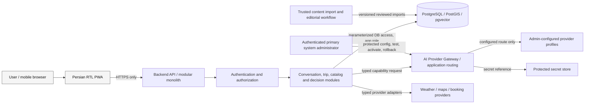

# AI Tourism — Security and Privacy Boundaries

- **Version:** 0.1
- **Status:** Phase 0 design baseline; legal and product policies remain open
- **Applies to:** MVP design and Phase 1 technical skeleton
- **Sources:** root `AGENTS.md`; Handoff v0.5 sections 3, 7, 9–13 and 17; current database DDL; architecture reference security and deployment sections; `docs/design/PWA_VISUAL_DESIGN_BRIEF_v0.1.md`.

## 1. Security objectives

1. The backend is the trust boundary. The browser must never connect directly to PostgreSQL or receive provider credentials.
2. Every user-owned object is isolated by server-validated identity and object-level authorization.
3. User input and retrieved/external content are data, not instructions or authorization.
4. Hard constraints, eligibility, scoring and ranking are enforced deterministically.
5. Only verified, editorially approved, non-synthetic data is exposed through production catalogue/retrieval queries.
6. Volatile or unknown travel facts are not fabricated by an LLM.
7. Personal data sent to remote providers, stored in logs or retained after account deletion is minimized and policy-controlled.

## 2. Logical data-flow and trust boundaries

Trust zones:

- **Public/untrusted:** browser, user text, uploaded content if later allowed, third-party pages and retrieved text.
- **Application boundary:** API validation, authentication, authorization, policy enforcement, domain services and output rendering.
- **Private data boundary:** PostgreSQL and its credentials, session signing/verification material, provider secrets, audit/usage telemetry.
- **External processor boundary:** approved LLM/weather/maps providers. Any personal-data transfer requires an explicit minimization and provider/legal review.
- **Privileged operations boundary:** migrations, content imports and editorial publication. Ordinary application users must not receive these privileges.

## 3. Identity, authentication and authorization

Authentication method and session mechanism are unresolved in [ADR-0006](../architecture/decisions/ADR-0006-authentication-and-session.md). The following controls are mandatory regardless of the selected method:

- Derive the acting user from a validated server-side session/token. Never trust a request-body or query-string `user_id`.
- Apply object-level authorization to every read, write, export and deletion operation.
- Keep the owner/migration role separate from the application role. Application code uses the least-privilege role and only the approved data views/operations.
- Use secure session handling after a mechanism is chosen: expiry, logout, revocation, recovery, CSRF defense where cookie-based and safe browser storage rules.
- Rate-limit authentication, verification-code or magic-link issuance, message submissions, recommendations and remote AI calls.
- Keep administrative content import and editorial approval privileges outside ordinary user roles.
- Treat AI provider management as a separate privileged control plane. Only the authenticated primary system administrator may manage profiles, models, credentials, connection tests, activation, deactivation, rollback or failover policy; anonymous and ordinary-user sessions have no access.
- Do not expose provider/model identifiers, endpoints, credentials, routing/failover details or provider/infrastructure status through ordinary-user APIs or PWA surfaces. Provider-specific failures map to provider-neutral safe errors.
- Provider credentials are server-side, protected at rest, and retrieved by secret reference. Secret values must not appear in public responses, browser storage, bundles, logs or audit records.
- Apply provider configuration changes as validated, versioned runtime updates with controlled rollback; audit actor, action, profile/version reference, outcome and time without recording secret values.
- Never enable automatic failover unless an administrator explicitly configures the policy. Local-to-remote fallback is not an implicit default.
- Do not implement authenticated endpoints as anonymous placeholders. Until ADR-0006 is accepted, Phase 1 can expose only non-user-data infrastructure health endpoints.

## 4. Data classification and handling

| Class | Examples | Required handling |
|---|---|---|
| Public, source-backed | Approved destination names/descriptions and approved source links | Publish only through approved catalogue/retrieval views; retain provenance and review state |
| Internal operational | Request IDs, provider status, latency, model alias, token counts, estimated cost | Restrict access; avoid raw content; use bounded retention |
| Personal | Email, phone, display name, preferences, conversations, trip origin/dates/budget, feedback | Purpose limitation, access control, minimization, defined retention/deletion and privacy notice |
| Secrets | DB passwords, provider API keys, session signing keys | Secret manager or ignored local environment; never commit, log or return to the browser |
| Synthetic/test-only | QA destinations/documents/chunks and seeded user graph | Explicit synthetic/test-only marker; never returned by production queries or used as real-world truth |
| Unverified / review-required | 15 legacy destination rows and 17 UNESCO entries awaiting editorial approval | Exclude from production publication views; never promote by inference |

## 5. Threats and required controls

| Threat / failure | Required control | Verification evidence |
|---|---|---|
| Broken object-level authorization (one user reads another user's data) | Server-derived identity; ownership checks in application/data access; deny-by-default | API tests for cross-user read/update/delete on every user-owned resource |
| Prompt injection from user or retrieved content | Treat content as untrusted; no policy override; tools only through explicit typed allowlists; validate model output | Adversarial prompt/retrieval tests and deterministic post-validation |
| LLM invents prices, coordinates, opening hours, routes or weather | Only pass source-backed facts; unknown stays unknown; deterministic decision core | Tests that missing/stale evidence cannot be turned into factual claims |
| Synthetic or unreviewed destination leak | Production views and queries require approved status, verified provenance and non-synthetic data | Existing publication gate tests plus API-level tests |
| Open redirect / malicious booking URL | Client supplies a known link identifier; backend resolves active allowlisted target | Reject arbitrary URLs and inactive/non-allowlisted link IDs |
| Secret or PII leakage in logs/errors | Structured redaction; safe exception mapping; no prompt/body dumps by default | Secret-pattern and PII redaction tests; log inspection |
| Unauthorized provider administration or silent provider failover | Separate admin authorization gate; audited, versioned changes; explicit failover policy; provider-neutral public errors | Negative authorization tests, audit review and failover-policy tests |
| Cost exhaustion / abuse | Per-user/global quotas, request bounds, timeouts, bounded retries and circuit behavior | Rate-limit, timeout and provider-failure tests |
| Database credential escalation | Dedicated least-privilege application role; owner role only for administration/migrations | Existing role-security SQL test plus connection-level tests |
| Cross-environment data leakage | Separate credentials and datasets for dev/test/staging/prod | Configuration validation and deployment review |
| Incomplete account deletion | Explicit deletion orchestration and retention policy; do not infer deletion from FK actions | Lifecycle tests covering live DB, provider copies, logs and backups |

## 6. Personal-data minimization and external AI processing

Before sending a request to a remote LLM:

- Send only fields needed for the current task.
- Do not send email, phone, account IDs, authentication/session tokens or unrelated conversation history by default.
- Pseudonymize identifiers in telemetry; separate operational correlation from direct identity.
- Treat retrieved documents and external provider output as untrusted and keep provenance/freshness metadata.
- Validate all structured output before it is persisted or used by the decision core.
- Keep provider/model aliases, prompt version, latency, token usage, estimated cost and outcome; do not retain raw prompts/responses in telemetry unless separately justified and approved.

Provider, hosting region, data processing terms and cross-border transfer review are open decisions. No paid provider or model is selected by these documents.

## 7. Retention and deletion — explicit design gap

The current schema does **not** make a complete account-deletion promise possible through a single user-row delete:

- preferences and consents cascade with the user;
- conversation and trip ownership references can become NULL while the conversation/messages/trip payload remains;
- feedback, outbound clicks and audit actor references may survive with a null user reference;
- knowledge sources/documents have provenance and deletion restrictions unrelated to a user account.

Therefore, do not implement `DELETE /api/v1/me` as a simple SQL delete. Before public use, the owner must approve:
1. retention periods by data class and lawful/operational purpose;
2. hard-delete vs anonymization rules for messages, trip details, feedback and click metadata;
3. handling of AI-provider copies, application logs, backups and restore procedures;
4. treatment of records required for security, abuse prevention or legal obligations;
5. user-facing notice, confirmation and completion semantics.

Until that policy is decided, the endpoint remains a documented future route only; no retention period or completion guarantee is invented here.

## 8. Logging, monitoring and incident hygiene

- Propagate one correlation/request ID across API, conversation, retrieval, decision and provider adapters.
- Log event type, outcome, latency and provider/model alias; omit raw message text and secrets by default.
- Restrict provider/model aliases and operational health to trusted operations/admin roles. Audit provider configuration changes without secret values; public product responses contain no provider or infrastructure details.
- Never return stack traces, SQL details, provider credentials or internal hostnames in user-facing errors.
- Establish measured latency/error/cost baselines before promising SLOs.
- Define who can inspect operational logs and audit records; apply retention and access controls.
- Document backup/restore and credential incident handling before staging/pilot.

## 9. Owner decisions required before relevant release

| Decision | Needed before |
|---|---|
| Authentication and session mechanism / provider | Any authenticated user-data endpoint |
| Primary administrator authentication, authorization, bootstrap/recovery and audit access | Any provider-management interface or route |
| Privacy notice, legal basis, retention and deletion policy | Real user data / public pilot |
| LLM provider, data region and processing terms | Sending real user conversation to a remote provider |
| Hosting region, secrets management and backup design | Staging/production |
| Editorial role and approval workflow | Publishing any source-verified but review-required destination |
| Abuse/rate-limit thresholds | Enabling real AI calls or public access |

## 10. Phase 1 minimum-security scope

The visual implementation must also follow `docs/design/PWA_VISUAL_DESIGN_BRIEF_v0.1.md`, including WCAG 2.2 AA target, reduced-motion support, keyboard/focus behavior, legible Persian typography and mobile responsive testing. Visual polish must not weaken accessibility or expose data.

Phase 1 may implement:

- configuration validation and safe local secret loading;
- non-sensitive liveness/readiness endpoints;
- request correlation ID and structured, redacted logs;
- database connection through the application role, not the owner role;
- health checks that do not leak credentials, raw database errors or internal environment data;
- deterministic tests proving that no external paid provider is called by default.

Phase 1 must not implement a placeholder authentication scheme, public user-data endpoints, account deletion, real LLM calls or provider credentials in the browser.
Phase 1 must not expose provider-management routes or provider/infrastructure diagnostics to ordinary product traffic. Deployed liveness/readiness probes are restricted to trusted operations; the provider gateway/control plane is a later-phase gate under ADR-0008 and ADR-0006.
