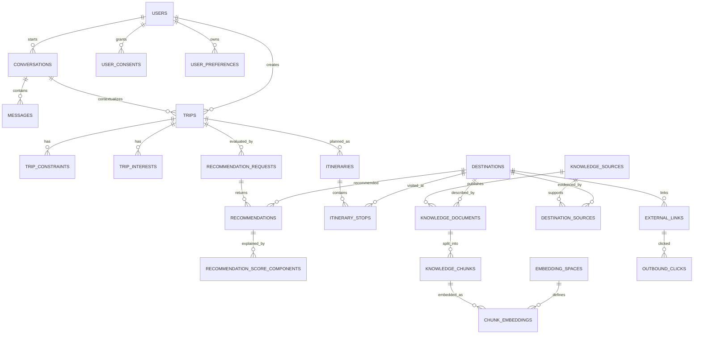

# AI Tourism MVP — Database Model v0.1

## Design boundaries

- One PostgreSQL 17 database for MVP, with schemas representing modular-monolith ownership.
- PostGIS stores geographic points as `geography(Point, 4326)`; the legacy latitude/longitude columns remain for import compatibility and a trigger synchronizes `location`.
- pgvector stores vectors, but the column does not hard-code a specific model dimension. `embedding_spaces.vector_dimension` is authoritative and a trigger validates every inserted/updated vector.
- No ANN index is created in this baseline. Exact nearest-neighbor retrieval is the correctness baseline; HNSW/IVFFlat is a measured optimization after the production embedding space and dataset size are known.
- No booking/payment transaction model is included in MVP. Only outbound external links and click tracking exist.

## Exact table inventory — 30 tables

| # | Schema | Table | Purpose |
|---:|---|---|---|
| 1 | identity | users | Minimal user/account identity; password hash only if local auth is used |
| 2 | identity | user_consents | Versioned privacy/terms consent history |
| 3 | identity | user_preferences | Long-term preferences distinct from trip-specific requirements |
| 4 | conversation | conversations | Conversation lifecycle and structured context |
| 5 | conversation | messages | User/assistant/system/tool message history |
| 6 | travel | trips | Structured travel request/profile |
| 7 | travel | trip_constraints | Explicit hard/soft requirements and constraints |
| 8 | travel | trip_interests | Weighted trip-specific interests |
| 9 | travel | itineraries | Versioned editable 1–3 day plan |
| 10 | travel | itinerary_stops | Ordered destination stops within a day |
| 11 | knowledge | knowledge_sources | Provenance/source registry |
| 12 | knowledge | destinations | Destination/POI catalogue, Persian aliases, hierarchy, data quality, geolocation |
| 13 | knowledge | destination_sources | Evidence/provenance links for destinations |
| 14 | knowledge | destination_tags | Lightweight tags retained from the initial project SQL |
| 15 | knowledge | destination_categories | Controlled destination taxonomy |
| 16 | knowledge | destination_category_map | Many-to-many destination/category relation |
| 17 | knowledge | knowledge_documents | RAG source documents and their provenance/version |
| 18 | knowledge | knowledge_chunks | Persisted document chunks |
| 19 | knowledge | embedding_spaces | Provider/model/revision/dimension/preprocessing identity |
| 20 | knowledge | chunk_embeddings | Embedding vectors associated with chunks and embedding spaces |
| 21 | recommendation | recommendation_requests | A traceable recommendation run and input snapshot |
| 22 | recommendation | recommendations | Ranked destination candidates and user-facing explanation |
| 23 | recommendation | recommendation_score_components | Criterion-level scores, weights and reason trace |
| 24 | integration | external_links | Outbound redirect targets only |
| 25 | integration | outbound_clicks | Click telemetry for external redirects |
| 26 | operations | feedback | User feedback linked to conversation/trip/recommendation |
| 27 | operations | ai_model_calls | Provider/model usage, token, latency and cost metadata |
| 28 | operations | audit_events | Security/business audit metadata without raw prompts or secrets |
| 29 | operations | dataset_import_batches | Import batch provenance, classification and record counts |
| 30 | system | schema_migrations | Applied migration checksums and timestamps |

PostGIS/pgvector may create objects in extension-owned schemas (for example `public.spatial_ref_sys`). They are not counted as application tables. The invariant test counts only the eight project-owned schemas above.

## Relationships

## Important semantics

### Destination data quality

`aliases` stores alternate Persian/common names for normalization and lookup; unverified aliases must follow the same source/review discipline as the canonical name.

`knowledge.destinations` is the unified place catalogue in this MVP. It represents destinations, cities/regions, attractions/POIs, routes and city experiences. `destination_type` identifies the type and `parent_destination_id` represents containment/hierarchy. An attraction is therefore a typed place row, not a separate MVP table. `destination_type` is key-shaped rather than a database enum; controlled user-facing categories are maintained separately through `destination_categories` and `destination_category_map`. A separate attraction subtype/table should be added only if independently owned fields or lifecycle are demonstrated and an ADR is approved.

`record_origin` is one of:

- `user_supplied_unverified`
- `verified_external`
- `synthetic_fixture`

`verification_status` and publication `status` are separate. A synthetic row uses `record_origin='synthetic_fixture'`, `is_synthetic=true`, `verification_status='not_applicable'`, and `status='test_only'`. A row from the existing project SQL is `user_supplied_unverified`, `pending`, `needs_review`, and has no coordinates (`coordinate_role=unknown`). The 10 initial UNESCO rows have source-backed identity/provenance and property-reference coordinates, but remain `status=needs_review`; source verification is not equivalent to product approval or publication. Their `reliability_score` is NULL and `data_confidence` remains 0 until the project defines a calibrated scoring rubric; neither field is populated with an arbitrary high confidence value.

A future production query must explicitly require a verified external record and an active publication status. It must not use `test_only` rows or merely treat `data_confidence=0` as safe.

### Source and knowledge provenance

A destination can be supported by multiple sources through `destination_sources`. Every RAG document has one `source_id`, optional `destination_id`, retrieval timestamp, content hash, ingestion state and source classification. Every chunk belongs to a document, and every embedding belongs to a chunk plus a separately versioned embedding space.

### Production eligibility views

The runtime application role has no direct SELECT access to raw knowledge tables. Its reads are restricted to explicit production views, including `knowledge.production_destinations`, `knowledge.production_destination_sources`, `knowledge.production_destination_categories`, `knowledge.production_destination_category_map`, `knowledge.production_destination_tags`, `knowledge.production_retrieval_documents`, `knowledge.production_retrieval_chunks`, `knowledge.active_embedding_spaces`, and `knowledge.production_chunk_embeddings`. The views require verified, active, non-synthetic destination records with at least one currently valid verified non-synthetic provenance link, and processed, verified, non-synthetic documents whose source is also verified and non-synthetic. A destination-linked document is eligible only when its destination is eligible. The pre-Codex seed intentionally exposes zero rows through both views.

### Replaceable embeddings

`embedding_spaces` stores provider type/name, model name/revision, vector dimension, similarity metric and preprocessing version. `chunk_embeddings.embedding` uses pgvector's unbounded `VECTOR` type and a trigger enforces the dimension configured by that embedding space. pgvector storage supports up to 16,000 dimensions; current HNSW/IVFFlat indexes on `vector` support up to 2,000 dimensions. Because this baseline creates no ANN index, the storage contract does not prematurely impose the ANN limit. This avoids tying the schema to BGE-M3, E5, MPNet, or a future remote embedding API.

When multiple dimensions/models are present, retrieval must filter by one `embedding_space_id` before distance calculation. The RAG contract test demonstrates separate 3D and 4D spaces; production spaces will use their real configured dimension. Exact search is retained as baseline. Create a dimension-specific ANN index only after model selection and performance measurement.

### Synthetic markers

Every seeded demo graph entity is marked `is_synthetic=true`; synthetic documents/chunks and destinations carry explicit synthetic origin. The test links use the reserved `.invalid` domain and are inactive. AI call metrics and outbound clicks remain zero because no actual provider call or real click occurred.

## Deliberately excluded from MVP

- bookings, tickets, cancellations, refunds and payment transactions
- hotel/flight inventory synchronisation
- Redis as a required dependency
- a separate vector database
- microservices, event broker and multi-agent orchestration
- permanent user-memory inference beyond explicit user preferences

These are future architecture options, not hidden MVP dependencies.
